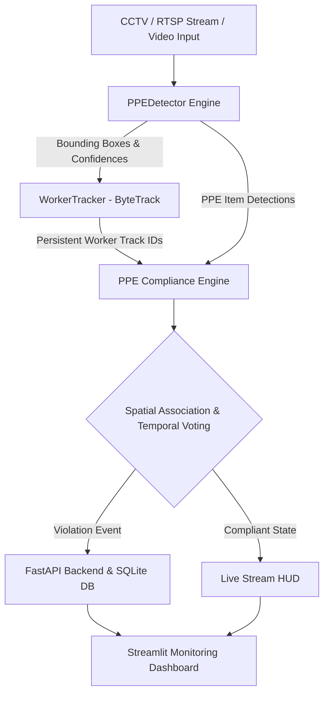

# PPE Detection & Safety Monitoring System 🦺🏗️

[](https://www.python.org/)
[-brightgreen.svg)](https://docs.ultralytics.com/)
[](https://github.com/ifzhang/ByteTrack)
[](https://fastapi.tiangolo.com/)
[](https://www.mysql.com/)
[](https://streamlit.io/)
[](https://onnxruntime.ai/)

An end-to-end Computer Vision system for real-time monitoring of Personal Protective Equipment (PPE) compliance on construction sites. Built with **Ultralytics YOLO11s**, **ByteTrack**, **FastAPI**, **MySQL / SQLite**, and **Streamlit**.

---

## 🎯 Project Highlights & Core Innovations
- **Audited & Curated Dataset:** Resolved zero-shot validation risks in Roboflow v30 by filtering into 9 specialized, balanced PPE classes (`Person`, `Hardhat`, `NO-Hardhat`, `Safety Vest`, `NO-Safety Vest`, `Mask`, `NO-Mask`, `Gloves`, `Safety Cone`).
- **High-Performance Detection:** Trained on Google Colab T4 GPU, achieving **82.1% Precision** and **9.6 ms inference latency (~104 FPS)**.
- **Anatomical Body-Part Spatial Association:** Instead of raw distance thresholds, assigns PPE items based on relative anatomical geometry:
  - `Hardhat` / `NO-Hardhat` $\rightarrow$ Head partition (top 0%–30%)
  - `Safety Vest` / `NO-Safety Vest` $\rightarrow$ Torso partition (20%–75%)
  - `Gloves` $\rightarrow$ Hands/flanks partition (45%–90%)
- **Anti-Flicker Temporal Voting:** Uses sliding-window voting across 15 frames ($~0.5\text{s}$) with hysteresis to eliminate false alarms caused by temporary occlusions or motion blur.
- **Microservices Architecture:** Modular backend with FastAPI REST APIs, SQLite persistence via SQLAlchemy, and an interactive Streamlit operations dashboard.

---

## 📐 System Architecture



---

## 📊 Benchmark Results

| Metric | Target | YOLO11s Achieved |
| :--- | :---: | :---: |
| **Precision (Overall)** | $\ge 80\%$ | **82.1%** |
| **mAP@50 (Overall)** | $\ge 60\%$ | **63.4%** |
| **Mask Precision / mAP50** | - | **93.7% / 85.7%** |
| **Hardhat Precision / mAP50**| - | **92.5% / 71.7%** |
| **Safety Vest Precision / mAP50** | - | **85.9% / 70.5%** |
| **Inference Latency (GPU T4)**| $< 33\text{ ms}$ (30 FPS) | **9.6 ms (~104 FPS)** |
| **Inference Latency (CPU ONNX)** | $< 200\text{ ms}$ | **95.8 ms (~10.4 FPS)** |
| **Inference Latency (CPU PyTorch)** | $< 200\text{ ms}$ | **121.0 ms (~8.3 FPS)** |

---

## 📁 Project Structure

```text
ppe-detection-safety-monitoring/
├── configs/
│   ├── data_ppe.yaml              # 9 Clean PPE classes configuration
│   ├── model_yolo11.yaml          # Training hyperparameters
│   ├── tracker_bytetrack.yaml     # ByteTrack tuning parameters
│   └── compliance_rules.yaml      # Spatial partitions & Temporal thresholds
├── data/
│   ├── raw/                       # Immutable raw dataset from Roboflow v30
│   └── processed/                 # Standardized 9-class dataset (717 images)
├── docs/
│   ├── dataset/DATASET_AUDIT_REPORT.md  # Comprehensive Data Profiling Report
│   ├── experiments/PHASE_02_MODEL_REPORT.md # Training & Validation Logs
│   └── models/MODEL_CARD.md       # Standardized Model Card
├── models/
│   ├── checkpoints/best.pt        # Trained YOLO11s PyTorch checkpoint
│   └── exported/ppe_best_yolo11.onnx # Exported ONNX Runtime model
├── src/
│   ├── common/                    # Types, BoundingBox geometry, CV2 visualizer
│   ├── detection/                 # OOP Detector wrapper (PyTorch & ONNX)
│   ├── tracking/                  # ByteTrack worker tracking & trajectory engine
│   ├── compliance/                # Spatial body partitioning & temporal voting
│   ├── database/                  # SQLAlchemy models, SQLite engine, CRUD
│   └── backend/                   # FastAPI REST API endpoints
├── frontend/
│   └── app.py                     # Streamlit CCTV Monitoring Dashboard
├── tests/                         # Pytest test suite (Geometry, Compliance, APIs)
├── deployment/
│   ├── Dockerfile.backend
│   ├── Dockerfile.frontend
│   └── docker-compose.yml
└── requirements.txt
```

---

## 🚀 Quick Start Guide

### 1. Installation
```bash
git clone https://github.com/<your-username>/ppe-detection-safety-monitoring.git
cd ppe-detection-safety-monitoring

python -m venv .venv
# Windows:
.venv\Scripts\activate
# Linux/macOS:
source .venv/bin/activate

pip install -r requirements.txt
```

### 2. Run Streamlit Dashboard
```bash
streamlit run frontend/app.py
```
Open your browser at `http://localhost:8501`.

### 3. Run FastAPI Backend
```bash
uvicorn src.backend.app:app --host 0.0.0.0 --port 8000 --reload
```
Interactive API documentation available at `http://localhost:8000/docs`.

### 4. Run Test Suite
```bash
pytest tests/ -v
```

### 5. Run via Docker Compose
```bash
cd deployment
docker-compose up --build
```

---

## 📜 License
Distributed under the CC BY 4.0 / MIT License.
